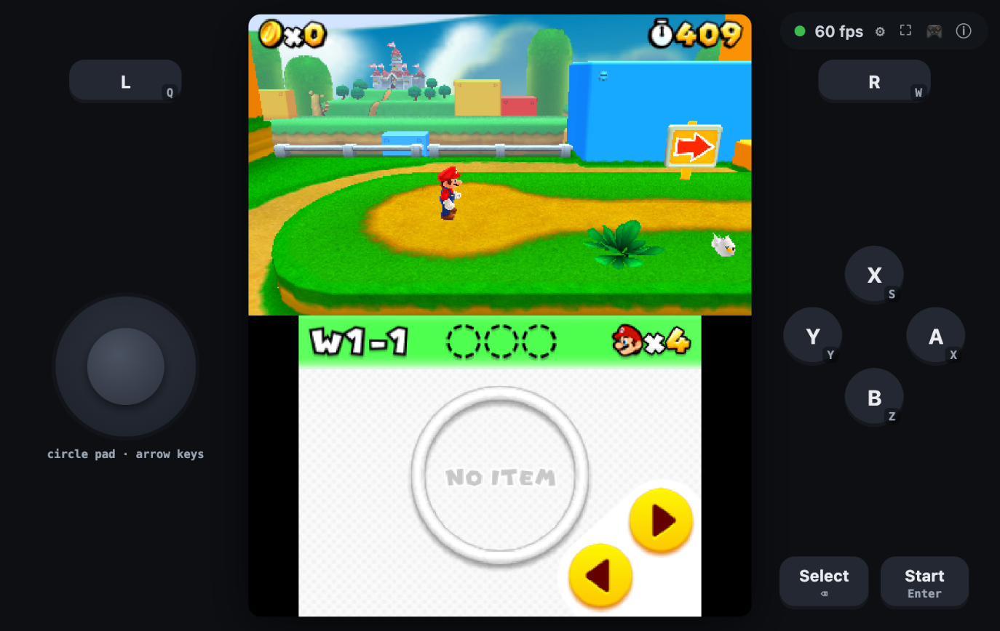
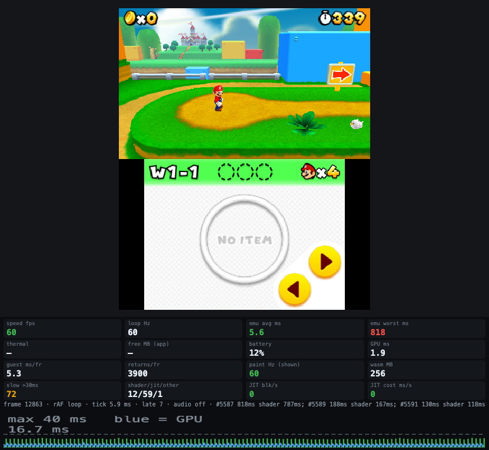

<div align="center">


# panda3ds-wasm

**Nintendo 3DS emulator ([Panda3DS](https://github.com/wheremyfoodat/Panda3DS)) running in the browser & iOS `WKWebView` with a runtime ARM → WebAssembly JIT**

[](https://panda.profy.top/)
[](docs/webkit-instances-and-batching.md)
[](docs/performance-notes.md)
[-000000?style=for-the-badge&logo=apple&logoColor=white)](docs/related-work-and-ios-hang.md)
[](LICENSE)

[](tests/jit)
[](tests/fp)
[-53%2F58_passing-brightgreen?style=flat-square)](docs/examples-status.md)
[](docs/forks.md)



<sub>The web player in Chrome on an M-series Mac: Super Mario 3D Land (own dump, not included), World 1-1, emulation speed 60 fps. Nothing is installed; the page only opens a game you pick.</sub>

<br><br>



<sub>The same scene with the diagnostics panel (test layout): 5.8 ms of emulator time per frame, GPU 2.4 ms. On battery power the browser repaints the page only about 32 times a second; plugged in it shows 60.</sub>

</div>

---

A Nintendo 3DS emulator ([Panda3DS](https://github.com/wheremyfoodat/Panda3DS)) that runs in a browser and inside `WKWebView` on an iPhone **without the JIT entitlement**: guest ARM code is recompiled to WebAssembly at run time, WebKit's own JIT compiles that, and the PICA GPU is drawn with WebGL2. Work in progress, no releases yet. Try it: **[panda.profy.top](https://panda.profy.top/)** (the page and the emulator only; you open your own game).

Feasibility study that came first: [wkwebview-jit-bench](https://github.com/gagarinyury/wkwebview-jit-bench). Which repository holds what: [docs/forks.md](docs/forks.md).

Licensed under **GPL-3.0-or-later**, like Panda3DS. See [LICENSE](LICENSE). Not affiliated with Nintendo or Apple. No game data, firmware or keys are included or will be; game images are read from your own dumps.

## Where it stands (October 2026)

Measured on an M-series Mac (Comet 154 and a clean Chromium 148, visible window) and an iPhone Air (iOS 27.0.1). ✅ = run and measured, 🔍 = not verified.

| | Result |
|---|---|
| Homebrew (devkitPro examples, Doom with Freedoom, Minicraft, ...) | ✅ iPhone: 53 of 58 examples at the last full device run (5 stop on a Panda `[FATAL]`); Doom and Minicraft start; 🔍 no fresh full Mac run of all examples |
| Super Mario 3D Land (own dump, not included) | ✅ playable from the title to a level with sound. **Mac (Chrome):** 60 fps emulation speed, also in heavy scenes (World 1-1: 5.6 ms of emulator time per frame). **iPhone Air:** menus and light scenes 55-63 fps, but **heavy 3D scenes (World 1-1) only 16-22 fps**: with the draw calls removed the same scene runs at 59-63 on the phone, so the cost there is the drawing (GPU / WebKit WebGL), not the CPU; the cause is still being narrowed down ([docs](docs/webkit-instances-and-batching.md)). The phone also heats up under load and then throttles |
| Mario Kart 7 (own dump) | ✅ playable all the way through in Chrome on the Mac: speed 60, 6.6 ms of emulator time and 1.4 ms of GPU time per frame, with short freezes (up to ~0.8 s) when a new shader or code is compiled; 🔍 iPhone not tried (1 GB image) |
| Super Smash Bros. for 3DS (2 GB dump) | ⚠ boots (image read in 1 MB pieces), then waits at an "extra data is corrupted" dialog and shows black screens after OK; being investigated |
| Audio | ✅ works (Panda's HLE DSP + miniaudio over Web Audio, 32768 Hz): music plays in Mario 3D Land after the first click or key (browsers keep sound suspended until a gesture); the first ~500 frames stutter while the JIT compiles. ✅ music and sound effects (jump, coins, blocks) in Mario 3D Land levels, checked by ear on the Mac; the attract/demo scene is mostly music only; ✅ iPhone Air: music plays (level meter and by ear); not checked: other games |
| Save data | ✅ `persist=1` keeps SD card and game saves in IndexedDB; ✗ no full save states |
| Input | ✅ keyboard, on-screen controller (circle pad, D-pad, ABXY, shoulders, Start/Select, each labelled with its key), touch on the lower screen |

### Not finished yet

- **iPhone, heavy 3D scenes:** World 1-1 runs at 16-22 fps (menus and light scenes 55-63). The cost is in the drawing, not in the CPU (see the table); the cause is being narrowed down. When the emulator runs slower than real time the sound crackles.
- **Safari on the Mac:** the same heavy scene about 44 fps (Chrome 60). Firefox and Chrome on Android: not tested.
- **Super Smash Bros. for 3DS** shows black screens; **Mario Kart 7** was not tried on the iPhone; only Mario 3D Land and Mario Kart 7 have been played through, other commercial games are untested.
- **Freezes** of 0.3-1 s when a new shader or a new region of game code is compiled; the first ~500 frames of a big game stutter.
- **No soft shadow** under characters in Mario 3D Land (trees and islands have them).
- **No save states** (game saves persist, `persist=1`); a few homebrew examples stop on a Panda `[FATAL]` (for example sockets) and five render suspiciously.

Audio notes: on iOS Web Audio is muted by the ringer switch, so the app declares a playback audio session and the page starts a looping silent `<audio>` clip on the first touch; the sound only starts after the first tap. The page used to switch sound off whenever the URL had `turbo=0` (the iOS app always passes it): fixed.

Gaps in the sound: the emulator makes sound a little slower than the device plays it when frames are heavy (e.g. 59.3 fps against 59.83), so the buffer ran dry and short gaps were audible (the picture hides this). The web build now reads the buffer with a dynamic rate control (the device speed follows the buffer fill by up to ±1.5 %, no audible pitch change): after loading the starved-sample counter stays flat. Big hiccups (a 300+ ms shader compile) can still leave a gap.

More audio notes: in the single-threaded web build the DSP used to wait for the audio device to drain its buffer and froze the page (a deadlock): it now drops the oldest audio instead; miniaudio's Web Audio code needs `HEAPF32` exported from the Emscripten runtime.

Draw cost on the phone: a micro benchmark of the draw calls (`env BENCH_DRAWS:1`) shows that creating a buffer for every upload is what is expensive in the browser's GL on the iPhone (17 us a draw, 6x the cost of one upload per frame), and that WebGPU would gain only ~30 % over the best WebGL2 mode. A rotating pool of buffers (opt-in, env `GL_STREAM_POOL:1`) is 6.4 us a draw in the benchmark, but gave no gain in the game on the iPhone and with 640 buffers iOS killed the page's process, so the default is still orphaning. Details and every rejected idea: [docs/performance-notes.md](docs/performance-notes.md); the WebKit instance cost and block packing: [docs/webkit-instances-and-batching.md](docs/webkit-instances-and-batching.md).

iPhone frame pacing: waiting for the GPU after every frame (a 1-pixel `readPixels`) looked like a fix on a light scene, but in the heavy demo scene the GPU needs 7-9 ms a frame and the wait serialised it with the 8 ms of CPU work: 35-47 fps. It is now off (env `GL_SYNC:1` turns it on as a measuring aid). `gl.finish()` returns at once on WebKit and measures nothing.

**Heavy 3D scenes in WebKit (17 Oct).** In Safari/WKWebView a heavy scene (World 1-1, ~800-1000 k guest ticks per frame) ran at 20-35 Hz while Chrome held 54-60. Findings, all in [docs/webkit-instances-and-batching.md](docs/webkit-instances-and-batching.md): (1) WebKit charges a fixed price per frame for every live `WebAssembly.Instance` (59 Hz up to 10 k instances, 43 Hz at 40 k, 25-33 Hz at 70 k; the number of functions does not matter), and the JIT made one instance per guest block; (2) Safari's page crashes came from executable memory, not RAM: JavaScriptCore makes a wasm-to-JS stub for every imported function of every module, and each block imported ~50 helpers. Fix: blocks import only memory and two tables, helpers are called with `call_indirect` through the host function table, and JS packs 256 blocks into one instance (`JIT_BATCH`, default 256; `0` off; `-1` old layout). Same route and scene in Safari on the Mac: 18.9 and 15.1 Hz without packing, 43.6 and 43.5 Hz with it (two pairs, the second one noisy on the Mac side; details in the doc). **On the iPhone Air the same build shows no gain in W1-1 (16-22 Hz before and after): there is no per-instance cost on the phone (59 Hz with 40 000 live instances). With all draw calls removed (`GL_NODRAW:1`) the same scene runs at 59-63 Hz on the phone, so the cost there is the drawing itself (GPU / ANGLE-Metal), not the JIT; which part of it is the open question.**

Known problems: no soft shadow under characters (Mario, enemies) in World 1-1 (shadows under trees/islands are drawn; open, [docs/related-work-and-ios-hang.md](docs/related-work-and-ios-hang.md)); freezes of 0.5-1 s the first time a new shader is compiled; the first ~500 frames of a big game run slower while the JIT compiles 50-100 thousand blocks; the rendering of five homebrew examples is suspicious and not compared with native Panda; on the iPhone one launch right after install was killed for memory (not reproduced). Open ideas are listed in [docs/upstream-pr-plan.md](docs/upstream-pr-plan.md) (what could go upstream) and the issues above.

### What made it fast (and what to remember)

- **WebGL buffer writes.** `glBufferSubData` into the stream-buffer rings costs 30-40 µs per call in a visible window (ANGLE/Metal copies the whole buffer while the GPU reads it), 500+ calls per frame = 15-25 ms. Orphaning with `glBufferData(size, data)` costs ~1 µs: Mario went from 15-22 fps to 60 fps. Headless Chrome hid this (idle GPU): **always measure in a visible window.**
- **Panda bugs found with real games:** `GLStateManager::setColourMask` assigned the arguments to the wrong side (no colour mask was ever applied), WebGL2 has no logic ops (NOOP/CLEAR are emulated), clip planes, depth/stencil write bits.
- **Big game images** (1-2 GB) are not loaded into memory but read in 1 MB pieces with `Range` requests (`lazy=` parameter).

## The web player (17 Oct 2026)

`web/index.html` opened without test parameters is a clean player: one button to open a game (or a free homebrew demo), a small fps pill, the game fitted to the window. It works on a phone in Safari too (iPhone Air: Mario 3D Land opened from the Files app, 59-63 fps in the light scenes).

- **Screens.** The core lays them out for the window (`web_layout`): portrait = one above the other, controls under them; touch + landscape = big main screen on the left, small second screen on the right, the controls float over the picture; desktop landscape = the screens in the middle and a column of controls on each side. It re-lays out on rotation and resizing, the controls never disappear (if there is no room under the screens they float over them).
- **Controls.** Circle pad, ABXY, L/R, Start/Select, each button shows its keyboard key on a mouse device and is bigger without captions on a touch screen. The circle pad is mirrored into the direction bits by the core, so menus see arrows (the on-screen cross is hidden, `?dpad=1` brings it back). Keyboard, standard gamepads (left stick = circle pad), vibration on touch.
- **Sizes.** The gear in the pill: main screen share (50-80 %), buttons size, buttons opacity; kept in the browser (`localStorage`).
- **Loading and errors.** The open button waits for the emulator core, a spinner with the progress shows while the game loads, and a script error or an emulator abort is printed on the page (a blank screen on a phone says nothing).
- **Test parameters switch to the diagnostic layout** (`name=`, `report=`, `fscript=`, `ff=`, `env=`, `frames=`, `turbo=`, the iOS app); `dev=1` forces it, `dev=0` forces the player. `touch=1` simulates a touch device on a desktop.
- **Live:** https://panda.profy.top/ (Cloudflare Pages, only the player, the core and three free demos; people open their own games). How it is built and deployed: [docs/deploy.md](docs/deploy.md). For a quick look before deploying: `ios/prepare-site.sh` + `scripts/serve-site.py` + a `cloudflared` tunnel.

## Run it

```sh
git clone https://github.com/gagarinyury/panda3ds-wasm.git && cd panda3ds-wasm
git clone --recurse-submodules -b wasm https://github.com/gagarinyury/Panda3DS.git      # the emulator core fork (see docs/forks.md)
git clone https://github.com/emscripten-core/emsdk.git && ./emsdk/emsdk install latest && ./emsdk/emsdk activate latest
source emsdk/emsdk_env.sh && scripts/build-core.sh
scripts/serve-web.py 8777 &       # static server with Range support, collects /live telemetry and /report
open "http://127.0.0.1:8777/web/index.html?rom=/run/examples/graphics__gpu__simple_tri.3dsx&gl=1"
```

Page parameters (`web/index.html`): `rom=<url>` game image or homebrew; `gl=1` WebGL2 renderer; `persist=1` keep saves; `lazy=0|1` read big images in pieces (automatic above 700 MB); `turbo=1` no frame limiter; `fscript=A:2100,B:3780` button presses by frame number (`A:frame[:hold]`, and `T:frame:hold:x:y` touches the lower screen at 0..319 x 0..239); (For tests, not for players: `fscript`, `fscriptfile`, `ff`, `dev`, `name`, `report`.) `fscriptfile=route-title.txt` reads the same list from a file next to the page (the route that reaches World 1-1 by itself, `web/route-title.txt`); `ff=<frame>` fast-forward until that frame; `preserve=1` keeps the drawing buffer readable (off by default, it slows WebKit); `audio=0|on|dsp|dev` sound off / on (default) / HLE DSP only / output device only; `beep=1` plays a 440 Hz test tone on the first click (checks the output device); `env=KEY:VALUE,...` environment for the core (e.g. `FS_DEBUG:1`, `AUDIO_DEBUG:1`, `GL_STREAM_SUBDATA:1` for the old buffer path, `JIT_BATCH:0` to switch off block packing, `GL_NODRAW:1` to skip all draw calls when measuring); `name=<id>`. Keys (also printed on the on-screen buttons): X or Space = A, Z = B, S = X, Y = Y, Q / W = L / R, Enter = Start, Backspace = Select, arrows = D-pad and circle pad together. A gamepad (standard mapping: Bluetooth/USB pads, left stick = circle pad) works too, and there is a full screen button; the page can be added to the iPhone home screen and then runs without browser bars. The gear in the status pill sets the share of the main screen, the size and the opacity of the on-screen buttons (kept in the browser). Opening the page without test parameters shows the clean player (one button to open a game, a small fps pill, on-screen controller with circle pad); `dev=1` brings back the diagnostic layout, which every test launch (`name=`, `report=`, `fscript=`, `ff=`, the iOS app) uses.

iPhone: `ios/prepare-site.sh`, then build `ios/PandaWeb.xcodeproj` for your device and install; `IOS_UDID=<udid> python3 scripts/ios-watch.py <seconds> -rom /docs/<image> -gl 1 -frames 1500` launches it and prints the console live.

### Tools for measuring

- `scripts/cdp-watch.mjs`, `cdp-trace.mjs`, `cdp-cpuprof.mjs`, `cdp-dispatch-stats.mjs`, `cdp-bufmem.mjs`, `cdp-drive.mjs`, `cdp-shot.mjs`: drive a Chrome with a debug port; watch progress, record a Chromium trace, press buttons, take screenshots.
- `scripts/safari-ab.py name=query ...` (env `ROUTE`, `SECS`): opens each variant in real Safari (the engine class of the iPhone's WKWebView), reads the page telemetry and prints loop/paint rates for light and heavy scenes. Don't touch Safari while it runs. `web/probe-glreplay.html` replays a recorded frame of WebGL calls (`web/glrec.js`) in a bare page, with ballast instances (`k`, `L` flags).
- **Live telemetry:** on `127.0.0.1` the page posts its panel (fps, emulator time, JIT, time inside WebGL calls, slow WebGL calls, `[jit]`/`[abort]`/warning lines) to `/live`; the server appends it to `run/web-reports/live-<name>.jsonl`, so what the person at the screen sees can be read from a terminal.

### Docs

- [docs/webkit-instances-and-batching.md](docs/webkit-instances-and-batching.md): why heavy scenes were slow in WebKit, executable-memory crashes, table-call layout, block packing, the route to World 1-1
- [docs/performance-notes.md](docs/performance-notes.md): every measured experiment, accepted and rejected
- [docs/related-work-and-ios-hang.md](docs/related-work-and-ios-hang.md): neighbouring projects, the iOS hang, the shadow-pillar fix, open shadow bug
- [docs/examples-status.md](docs/examples-status.md): homebrew examples; [docs/forks.md](docs/forks.md): which repo holds what; [docs/upstream-pr-plan.md](docs/upstream-pr-plan.md): what could go upstream (nothing sent)

---

The older engineering log (JIT backend verification, speed tables, the idle-thread fix) is in [docs/engineering-log.md](docs/engineering-log.md).

## Build

```sh
git clone https://github.com/emscripten-core/emsdk.git && ./emsdk/emsdk install latest && ./emsdk/emsdk activate latest
# the forks carry all changes (branches wasm / wasm32):
git clone --recurse-submodules -b wasm https://github.com/gagarinyury/Panda3DS.git
# or, from upstream: git clone --recurse-submodules https://github.com/wheremyfoodat/Panda3DS.git, then
#   git -C Panda3DS apply ../patches/panda3ds-emscripten.patch && git -C Panda3DS/third_party/dynarmic apply ../../../patches/dynarmic-wasm32.patch
source emsdk/emsdk_env.sh && scripts/build-core.sh && cmake --build build-core
```

Forks: [Panda3DS `wasm`](https://github.com/gagarinyury/Panda3DS/tree/wasm), [dynarmic `wasm32`](https://github.com/gagarinyury/dynarmic/tree/wasm32). The patches were made against Panda3DS `92e53d2` and Dynarmic `e77b1ba` (`scripts/regen-patches.sh`).
