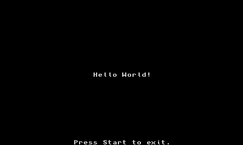

# panda3ds-wasm

A Nintendo 3DS emulator ([Panda3DS](https://github.com/wheremyfoodat/Panda3DS)) that runs in a browser and inside `WKWebView` on an iPhone **without the JIT entitlement**: guest ARM code is recompiled to WebAssembly at run time, WebKit's own JIT compiles that, and the PICA GPU is drawn with WebGL2. Work in progress, local dev setup, no releases.

Feasibility study that came first: [wkwebview-jit-bench](https://github.com/gagarinyury/wkwebview-jit-bench). Which repository holds what: [docs/forks.md](docs/forks.md).

Licensed under **GPL-3.0-or-later**, like Panda3DS. See [LICENSE](LICENSE). Not affiliated with Nintendo or Apple. No game data, firmware or keys are included or will be; game images are read from your own dumps.

## Where it stands (October 2026)

Measured on an M-series Mac (Comet 154 and a clean Chromium 148, visible window) and an iPhone Air (iOS 27.0.1). ✅ = run and measured, 🔍 = not verified.

| | Result |
|---|---|
| Homebrew (devkitPro examples, Doom with Freedoom, Minicraft, ...) | ✅ iPhone: 53 of 58 examples at the last full device run (5 stop on a Panda `[FATAL]`); Doom and Minicraft start; 🔍 no fresh full Mac run of all examples |
| Super Mario 3D Land (own dump, not included) | ✅ playable from the title to a level with sound: ~60 fps on the Mac, 55-63 fps on the iPhone when it is cool (the phone heats up under load and then throttles to 30-37 fps) |
| Mario Kart 7 (own dump) | ✅ ~55-60 fps on the Mac (panel readings and by eye); ✅ 17 Oct (user's report, Chrome on the Mac over the temporary tunnel): playable all the way through, panel at frame 16 774: speed 59.8, emulator 6.6 ms a frame, GPU 1.4 ms, worst frame 805 ms (shader/JIT hitches); browser repaints only 32 a second on battery power (plugged in: not measured); 🔍 iPhone not tried (1 GB image) |
| Super Smash Bros. for 3DS (2 GB dump) | ⚠ boots (image read in 1 MB pieces), then waits at an "extra data is corrupted" dialog and shows black screens after OK; being investigated |
| Audio | ✅ works (Panda's HLE DSP + miniaudio over Web Audio, 32768 Hz): music plays in Mario 3D Land after the first click or key (browsers keep sound suspended until a gesture); the first ~500 frames stutter while the JIT compiles. ✅ music and sound effects (jump, coins, blocks) in Mario 3D Land levels, checked by ear on the Mac; the attract/demo scene is mostly music only; ✅ iPhone Air: music plays (level meter and by ear); not checked: other games |
| Save data | ✅ `persist=1` keeps SD card and game saves in IndexedDB; ✗ no full save states |
| Input | ✅ keyboard, on-screen controller (circle pad, D-pad, ABXY, shoulders, Start/Select, each labelled with its key), touch on the lower screen |

Audio notes: on iOS Web Audio is muted by the ringer switch, so the app declares a playback audio session and the page starts a looping silent `<audio>` clip on the first touch; the sound only starts after the first tap. The page used to switch sound off whenever the URL had `turbo=0` (the iOS app always passes it): fixed.

Gaps in the sound: the emulator makes sound a little slower than the device plays it when frames are heavy (e.g. 59.3 fps against 59.83), so the buffer ran dry and short gaps were audible (the picture hides this). The web build now reads the buffer with a dynamic rate control (the device speed follows the buffer fill by up to ±1.5 %, no audible pitch change): after loading the starved-sample counter stays flat. Big hiccups (a 300+ ms shader compile) can still leave a gap.

More audio notes: in the single-threaded web build the DSP used to wait for the audio device to drain its buffer and froze the page (a deadlock): it now drops the oldest audio instead; miniaudio's Web Audio code needs `HEAPF32` exported from the Emscripten runtime.

Draw cost on the phone: a micro benchmark of the draw calls (`env BENCH_DRAWS:1`) shows that creating a buffer for every upload is what is expensive in the browser's GL on the iPhone (17 us a draw, 6x the cost of one upload per frame), and that WebGPU would gain only ~30 % over the best WebGL2 mode. A rotating pool of buffers (opt-in, env `GL_STREAM_POOL:1`) is 6.4 us a draw in the benchmark, but gave no gain in the game on the iPhone and with 640 buffers iOS killed the page's process, so the default is still orphaning. Details and every rejected idea: [docs/performance-notes.md](docs/performance-notes.md); the WebKit instance cost and block packing: [docs/webkit-instances-and-batching.md](docs/webkit-instances-and-batching.md).

iPhone frame pacing: waiting for the GPU after every frame (a 1-pixel `readPixels`) looked like a fix on a light scene, but in the heavy demo scene the GPU needs 7-9 ms a frame and the wait serialised it with the 8 ms of CPU work: 35-47 fps. It is now off (env `GL_SYNC:1` turns it on as a measuring aid). `gl.finish()` returns at once on WebKit and measures nothing.

**Heavy 3D scenes in WebKit (17 Oct).** In Safari/WKWebView a heavy scene (World 1-1, ~800-1000 k guest ticks per frame) ran at 20-35 Hz while Chrome held 54-60. Findings, all in [docs/webkit-instances-and-batching.md](docs/webkit-instances-and-batching.md): (1) WebKit charges a fixed price per frame for every live `WebAssembly.Instance` (59 Hz up to 10 k instances, 43 Hz at 40 k, 25-33 Hz at 70 k; the number of functions does not matter), and the JIT made one instance per guest block; (2) Safari's page crashes came from executable memory, not RAM: JavaScriptCore makes a wasm-to-JS stub for every imported function of every module, and each block imported ~50 helpers. Fix: blocks import only memory and two tables, helpers are called with `call_indirect` through the host function table, and JS packs 256 blocks into one instance (`JIT_BATCH`, default 256; `0` off; `-1` old layout). Same route and scene in Safari on the Mac: 18.9 and 15.1 Hz without packing, 43.6 and 43.5 Hz with it (two pairs, the second one noisy on the Mac side; details in the doc). **On the iPhone Air the same build shows no gain in W1-1 (16-22 Hz before and after): there is no per-instance cost on the phone (59 Hz with 40 000 live instances). With all draw calls removed (`GL_NODRAW:1`) the same scene runs at 59-63 Hz on the phone, so the cost there is the drawing itself (GPU / ANGLE-Metal), not the JIT; which part of it is the open question.**

Known problems: no soft shadow under characters (Mario, enemies) in World 1-1 (shadows under trees/islands are drawn; open, [docs/related-work-and-ios-hang.md](docs/related-work-and-ios-hang.md)); freezes of 0.5-1 s the first time a new shader is compiled; the first ~500 frames of a big game run slower while the JIT compiles 50-100 thousand blocks; the rendering of five homebrew examples is suspicious and not compared with native Panda; on the iPhone one launch right after install was killed for memory (not reproduced). Open ideas are listed in [docs/upstream-pr-plan.md](docs/upstream-pr-plan.md) (what could go upstream) and the issues above.

### What made it fast (and what to remember)

- **WebGL buffer writes.** `glBufferSubData` into the stream-buffer rings costs 30-40 µs per call in a visible window (ANGLE/Metal copies the whole buffer while the GPU reads it), 500+ calls per frame = 15-25 ms. Orphaning with `glBufferData(size, data)` costs ~1 µs: Mario went from 15-22 fps to 60 fps. Headless Chrome hid this (idle GPU): **always measure in a visible window.**
- **Panda bugs found with real games:** `GLStateManager::setColourMask` assigned the arguments to the wrong side (no colour mask was ever applied), WebGL2 has no logic ops (NOOP/CLEAR are emulated), clip planes, depth/stencil write bits.
- **Big game images** (1-2 GB) are not loaded into memory but read in 1 MB pieces with `Range` requests (`lazy=` parameter).

## Run it

```sh
git clone --recurse-submodules -b wasm https://github.com/gagarinyury/Panda3DS.git      # the emulator core fork (see docs/forks.md)
git clone https://github.com/emscripten-core/emsdk.git && ./emsdk/emsdk install latest && ./emsdk/emsdk activate latest
source emsdk/emsdk_env.sh && scripts/build-core.sh && cmake --build build-core --target AlberWeb -j8
scripts/serve-web.py 8777 &       # static server with Range support, collects /live telemetry and /report
open "http://127.0.0.1:8777/web/index.html?rom=/run/examples/graphics__gpu__simple_tri.3dsx&gl=1"
```

Page parameters (`web/index.html`): `rom=<url>` game image or homebrew; `gl=1` WebGL2 renderer; `persist=1` keep saves; `lazy=0|1` read big images in pieces (automatic above 700 MB); `turbo=1` no frame limiter; `fscript=A:2100,B:3780` button presses by frame number (`A:frame[:hold]`, and `T:frame:hold:x:y` touches the lower screen at 0..319 x 0..239); `fscriptfile=route-title.txt` reads the same list from a file next to the page (the route that reaches World 1-1 by itself, `web/route-title.txt`); `ff=<frame>` fast-forward until that frame; `preserve=1` keeps the drawing buffer readable (off by default, it slows WebKit); `audio=0|on|dsp|dev` sound off / on (default) / HLE DSP only / output device only; `beep=1` plays a 440 Hz test tone on the first click (checks the output device); `env=KEY:VALUE,...` environment for the core (e.g. `FS_DEBUG:1`, `AUDIO_DEBUG:1`, `GL_STREAM_SUBDATA:1` for the old buffer path); `name=<id>`. Keys (also printed on the on-screen buttons): X or Space = A, Z = B, S = X, Y = Y, Q / W = L / R, Enter = Start, Backspace = Select, arrows = D-pad and circle pad together. Opening the page without test parameters shows the clean player (one button to open a game, a small fps pill, on-screen controller with circle pad); `dev=1` brings back the diagnostic layout, which every test launch (`name=`, `report=`, `fscript=`, `ff=`, the iOS app) uses.

iPhone: `ios/prepare-site.sh`, then build `ios/PandaWeb.xcodeproj` for your device and install; `IOS_UDID=<udid> python3 scripts/ios-watch.py <seconds> -rom /docs/<image> -gl 1 -frames 1500` launches it and prints the console live.

### Tools for measuring

- `scripts/cdp-watch.mjs`, `cdp-trace.mjs`, `cdp-cpuprof.mjs`, `cdp-dispatch-stats.mjs`, `cdp-bufmem.mjs`, `cdp-drive.mjs`, `cdp-shot.mjs`: drive a Chrome with a debug port; watch progress, record a Chromium trace, press buttons, take screenshots.
- `scripts/safari-ab.py name=query ...` (env `ROUTE`, `SECS`): opens each variant in real Safari (the engine class of the iPhone's WKWebView), reads the page telemetry and prints loop/paint rates for light and heavy scenes. Don't touch Safari while it runs. `web/probe-glreplay.html` replays a recorded frame of WebGL calls (`web/glrec.js`) in a bare page, with ballast instances (`k`, `L` flags).
- **Live telemetry:** on `127.0.0.1` the page posts its panel (fps, emulator time, JIT, time inside WebGL calls, slow WebGL calls, `[jit]`/`[abort]`/warning lines) to `/live`; the server appends it to `run/web-reports/live-<name>.jsonl`, so what the person at the screen sees can be read from a terminal.

### Docs

- [docs/webkit-instances-and-batching.md](docs/webkit-instances-and-batching.md): why heavy scenes were slow in WebKit, executable-memory crashes, table-call layout, block packing, the route to World 1-1
- [docs/performance-notes.md](docs/performance-notes.md): every measured experiment, accepted and rejected
- [docs/related-work-and-ios-hang.md](docs/related-work-and-ios-hang.md): neighbouring projects, the iOS hang, the shadow-pillar fix, open shadow bug
- [docs/examples-status.md](docs/examples-status.md): homebrew examples; [docs/forks.md](docs/forks.md): which repo holds what; [docs/upstream-pr-plan.md](docs/upstream-pr-plan.md): what could go upstream (nothing sent)

---

## Engineering log: JIT backend verification

Details of the JIT backend and its tests (written while the backend was being built; the numbers are from those runs).

## Status

| Check | Result |
|---|---|
| Dynarmic A32 front end + IR build with Emscripten (wasm32) | ✅ two small fixes (`size_t` assumed 64-bit, function pointers cast to `u64`) |
| Real ARMv6 code decoded to IR inside WASM | ✅ [`probe/ir_dump.cpp`](probe/ir_dump.cpp), output in [`probe/data/hash_loop.ir.txt`](probe/data/hash_loop.ir.txt): a 29-instruction IR block optimises to 17 |
| Whole Panda3DS core + SDL front end links to `Alber.js` / `Alber.wasm` (first link 5.2 MB; the browser build `AlberWeb.wasm` is now ~9 MB) | ✅ at the time ~50 lines of CMake/source changes in Panda3DS; the fork has grown since, see [docs/forks.md](docs/forks.md) |
| IR → WASM backend (`Dynarmic::A32::Jit` for wasm) | ✅ (packed halving/saturating ops added for Smash Bros: checked against an independent reference on 400 k vectors) v0: executes real ARM and Thumb code; integer, memory, flags, conditions, branches, calls, CP15 TLS. VFP scalar float/double (add, sub, mul, div, sqrt, compare, conversions) via bit-exact soft-float. Scalar saturation (SSAT, USAT, QADD, QSUB) and ARMv6 packed SIMD (uadd8, usub8, sadd8, ssub8, 16-bit packed, sel, usada8). Not yet: NEON/vector, 64-bit shifts, fast inline FP |
| VFP fast path through the JIT vs. the soft-float reference ([`tests/jit/fpjit.sh`](tests/jit/fpjit.sh)): 10 FPSCR modes × 123 k operand pairs × add/sub/mul/div/sqrt/vcmp | ✅ 7.4 M bit-exact comparisons (and a negative control that fails when the rounding fix is removed) |
| Differential tests ([`tests/jit`](tests/jit)): 14 C kernels × ARM/Thumb × 32 inputs vs. the same C compiled to wasm | ✅ 34/34 pass (14 integer kernels × ARM/Thumb, 6 VFP kernels; return value and scratch memory compared) |
| Soft-float VFP vs. Apple Silicon FPU ([`tests/fp`](tests/fp)): add/sub/mul/div/sqrt/cmp/convert, f32+f64, all 16 FPCR modes (rounding × FZ × DN), result **and** exception flags | ✅ 2 785 536 comparisons, 0 mismatches (after fixing one Dynarmic bug in float → unsigned conversion) |
| A homebrew `.3dsx` runs through the real Panda3DS core with the WASM JIT (headless, Node) | ✅ [`guest/hello.c`](guest/hello.c): prints via `svcOutputDebugString`, 2 M-iteration hash loop and a VFP computation; both results equal the native reference bit for bit (`scripts/test-hello.sh`) |
| A real **libctru** homebrew (devkitPro `3ds-examples/graphics/printing/hello-world`, built with the official devkitARM image) runs to its main loop and draws its text | ✅ [`assets/ctr-hello-world-top.png`](assets/ctr-hello-world-top.png) is the emulated top screen (`scripts/test-ctr-hello.sh`) |
| **In a real browser**: `web/index.html` drives the core from `requestAnimationFrame` and paints both screens on canvases. Verified in **Safari 27.0.1 (WebKit)** and Comet (Chromium 154) | ✅ libctru hello-world: 120 frames, avg 1.16 ms/frame in Safari, same 520 lit pixels as Node. 8 more examples (opus/vorbis decoding, box2d, sockets, threads, input…) run in Safari with pixel counts identical to Node |
| `WKWebView` on an iPhone | ✅ iPhone Air, iOS 27.0.1: the app in [`ios/`](ios) (WKWebView, `panda://` scheme) runs the same page; homebrew examples and commercial-game tests below |
| 3D rendering (PICA → WebGL2) | ✅ Panda3DS's OpenGL ES renderer on WebGL2: 20/20 `graphics/gpu` examples draw on iPhone and in Comet (a few look suspicious and are not verified against native Panda) |

<p align="center"></p>

The only place Panda3DS touches Dynarmic is `Dynarmic::A32::Jit` (see `src/core/CPU/cpu_dynarmic.cpp`), so the new backend plugs in behind the same interface. (Panda3DS itself was later changed in the renderer, kernel and file system: see the fork's `wasm` branch.)

## Current state (Oct 2026)

Verified by running it (not by reading the code):

- **Homebrew:** on the iPhone 53 of the 58 devkitPro examples ran at the last full device run (5 stop on a Panda `[FATAL]`); Doom (PrBoom+ 3DS with Freedoom) runs; Minicraft, GameYob and others start.
- **A commercial game** (Super Mario 3D Land, an own dump that is not included): boots, menus ~60 fps, 3D scenes 25–40 fps on a Mac (Comet/Chrome) and on the iPhone (at that time; see the top of this file and docs/webkit-instances-and-batching.md for later numbers). About 50–60 thousand JIT modules (now packed 256 per instance) / 33 MB of generated WASM, 256 MB guest memory + the 512 MB image streamed into MEMFS.
- **Rendering fixes found with it:** Panda's `GLStateManager::setColourMask` assigned the arguments to the wrong side (no mask was ever applied), WebGL2 has no logic ops (NOOP/CLEAR are emulated), clip planes, depth/stencil write bits, a stream-buffer size that cost 14 → 59 fps in menus on ANGLE/Metal.
- **Not done (at the time; audio has been working since, see the top of this file):** analog stick, full save states (game saves persist in IndexedDB with `persist=1`), exact frame pacing in WebKit, see `docs/`.
- **The 3D slowdown, found and fixed (16 Oct 2026):** in a visible browser window every `glBufferSubData` into the stream-buffer rings cost 30–40 µs (ANGLE/Metal copies the whole buffer when the GPU still reads it), 500+ calls per frame = 15–25 ms. Headless Chrome hid it (GPU idle). Writing each buffer with an orphaning `glBufferData(size, data)` costs ~1 µs: the same game scene went from 15–22 fps to a steady 60 fps (emulator 30–60 ms → 5–10 ms per frame), measured in Comet and in a clean Chromium window. Lesson: measure in a visible window on the real screen, never only headless. The page reports its panel to `/live` on the dev server (`scripts/serve-web.py`) so the developer can see what the person at the screen sees.
- **Still open:** 0.5–1 s freezes the first time a new shader is compiled (`getShaderParameter` blocks), save states.

## Speed (Node 25 / V8, guest MIPS, higher is better)

Measured with [`tests/jit/bench.sh`](tests/jit/bench.sh). Real 3DS needs ~270 MIPS per core (Old) / ~800 MIPS (New).

| kernel | interpreter-style dispatch + callbacks | + block chaining | + inline memory | + inline VFP |
|---|---:|---:|---:|---:|
| `b_hash` tight integer loop | 157 | 1 411 | 1 486 | **1 446** |
| `b_memsum` loads/stores | 213 | 684 | 1 646 | **1 625** |
| `b_calls` recursion, call/return | 97 | 309 | 911 | **917** |
| `b_fdot` VFP dot products | 120 | 200 | 248 | **1 659** |

Block chaining = blocks tail-call each other through a shared function table (`return_call_indirect`) via a direct-mapped cache.
Inline memory = the same page tables Panda3DS uses, indexed from generated code. Inline VFP = add/sub/mul/div/sqrt/compare in
round-to-nearest and round-to-zero modes (the 3DS default is round-to-zero + flush-to-zero + default-NaN) with NaN cases delegated
to the bit-exact helper. The inline path does not accumulate FPSR exception flags.

### In the browser

```sh
scripts/serve-web.py 8765 &                      # static server + report collector
open "http://127.0.0.1:8765/web/index.html?rom=/run/ctr-hello.3dsx"
python3 scripts/web-examples.py Safari threads__thread-basic audio__opus-decoding   # batch run through real Safari
```

First frames hitch (worst frame 60–200 ms) while the first blocks are compiled; steady state is 1–6 ms/frame (budget 16.7).



### Idle thread fix (Panda3DS)

When every guest thread is waiting, Panda3DS runs an idle thread that loops on `svcSleepThread(0)`. It already skips ahead to the next
event, but the CPU time slice (sized for a whole frame when it began) kept running, so the idle loop spun through the rest of it:
~300 000 supervisor calls per frame, ~20 ms/frame for a program that does nothing. The fix (`Kernel::sleepThread` + `CPU::stopSlice`)
ends the slice after the skip so the scheduler handles the event immediately.
All 58 devkitPro examples: mean 16.9 → 2.3 ms/frame, worst 24.2 → 5.6 ms/frame (budget 16.7 ms), same pass rate (54/58).

## Build

```sh
git clone https://github.com/emscripten-core/emsdk.git && ./emsdk/emsdk install latest && ./emsdk/emsdk activate latest
# the forks carry all changes (branches wasm / wasm32):
git clone --recurse-submodules -b wasm https://github.com/gagarinyury/Panda3DS.git
# or, from upstream: git clone --recurse-submodules https://github.com/wheremyfoodat/Panda3DS.git, then
#   git -C Panda3DS apply ../patches/panda3ds-emscripten.patch && git -C Panda3DS/third_party/dynarmic apply ../../../patches/dynarmic-wasm32.patch
source emsdk/emsdk_env.sh && scripts/build-core.sh && cmake --build build-core
```

Forks: [Panda3DS `wasm`](https://github.com/gagarinyury/Panda3DS/tree/wasm), [dynarmic `wasm32`](https://github.com/gagarinyury/dynarmic/tree/wasm32). The patches were made against Panda3DS `92e53d2` and Dynarmic `e77b1ba` (`scripts/regen-patches.sh`).
